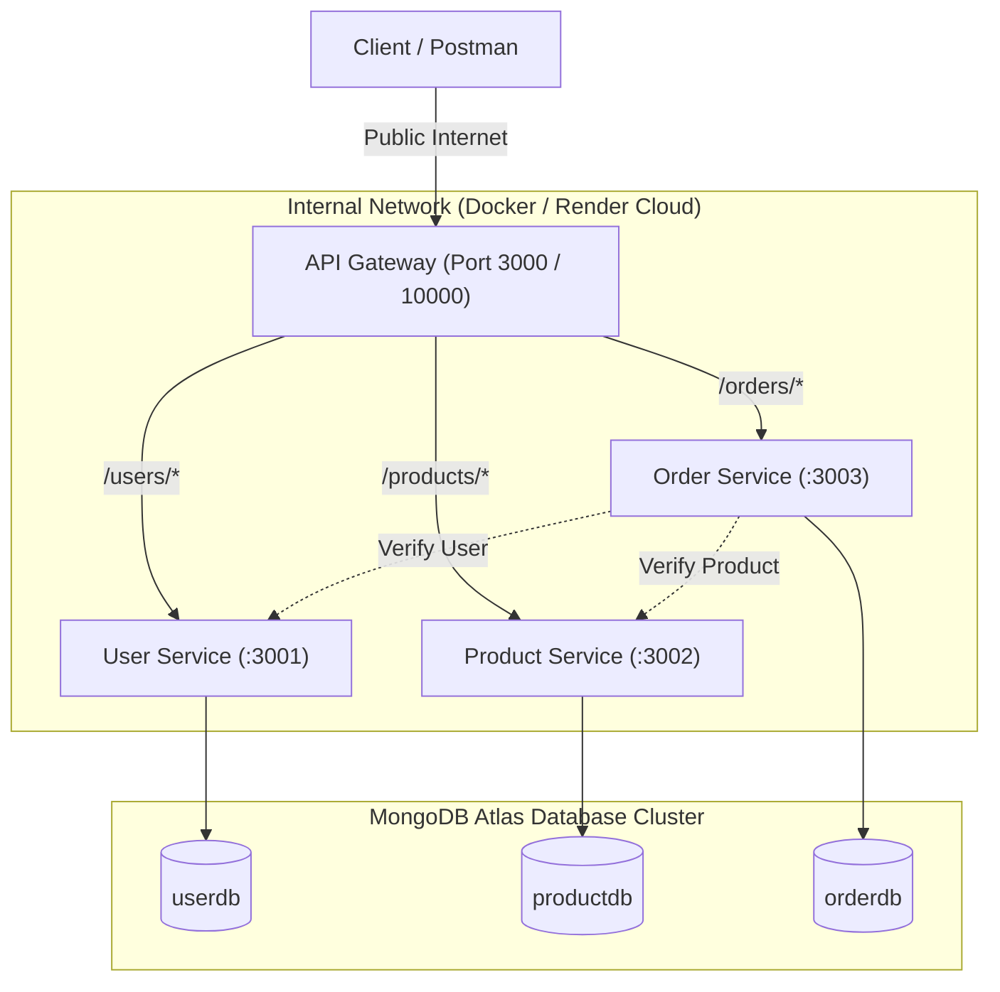

# LAB 7 – API Gateway, Service Discovery & Cloud Deployment

## 1. Objective

The objective of Lab 7 is to evolve the containerized microservices architecture built in Lab 6 into a production-grade, cloud-deployed system:
1. **API Gateway**: Build and deploy an API Gateway as the single public entry point for all client requests, hiding internal microservice topology, centralizing cross-cutting concerns (logging, error handling), and isolating backend services inside private networks.
2. **Service Discovery (Configuration-Based)**: Decouple service locations from routing code using externalized configuration and environment variables, enabling location updates without code changes.
3. **Cloud Deployment**: Containerize and deploy the entire multi-service system (`api-gateway`, `user-service`, `product-service`, `order-service`, backed by **MongoDB Atlas**) to a public cloud platform (**Render**), making the system accessible over the public internet.

---

## 2. Microservices Architecture & Flow

### Full-Stack Request Flow:
```text
Client / Postman
       │
       ▼ (Public HTTPS)
┌────────────────────────────────────────────────────────┐
│             API Gateway (Port 3000 / 10000)            │
│  - Single Public Entry Point                           │
│  - Request Logging & Metrics                           │
│  - 502/503 Centralized Failure Handling               │
│  - Service Discovery / Config-Driven Routing           │
└──────┬──────────────────┬───────────────────┬──────────┘
       │                  │                   │
       ▼                  ▼                   ▼
┌──────────────┐   ┌──────────────┐   ┌──────────────┐
│ User Service │   │Product Serv. │   │ Order Service│
│ (Port 3001)  │   │ (Port 3002)  │   │ (Port 3003)  │
└──────┬───────┘   └──────┬───────┘   └───────┬──────┘
       │                  │                   │
       │                  │        Calls GET /users/{id}
       │                  │◄────── & GET /products/{id}
       ▼                  ▼                   ▼
┌──────────────┐   ┌──────────────┐   ┌──────────────┐
│ MongoDB Atlas│   │ MongoDB Atlas│   │ MongoDB Atlas│
│   (userdb)   │   │  (productdb) │   │   (orderdb)  │
└──────────────┘   └──────────────┘   └──────────────┘
```

### Mermaid Architecture Diagram:


---

## 3. Discussion Questions

### Question 1: Why introduce an API Gateway instead of letting clients call each service directly?
- **Single Entry Point**: Clients interact with a single stable domain/hostname, shielding them from backend microservice fragmentation, port proliferation, and service boundary refactoring.
- **Hiding Internal Architecture & Security**: Backend microservices (`user-service`, `product-service`, `order-service`) remain completely hidden within a private network with no public ports exposed. Only the gateway faces the internet.
- **Centralized Cross-Cutting Concerns**: Authentication, SSL/TLS termination, rate limiting, request tracing/logging, and health audits are handled uniformly at the gateway rather than duplicated in each service.
- **Resilience & Centralized Error Handling**: Unreachable or failing downstream microservices are caught by the gateway and returned as clean, standard `502 Bad Gateway` or `503 Service Unavailable` JSON responses, preventing client connection hangs or timeouts.

### Question 2: Static / Config-Based Discovery vs. Dynamic Service Discovery
- **Static / Config-Based Approach (This Lab)**:
  - Service URLs are injected as environment variables (`USER_SERVICE_URL`, `PRODUCT_SERVICE_URL`, `ORDER_SERVICE_URL`).
  - *Pros*: Simple, deterministic, zero third-party dependencies, perfectly suited for container orchestration and fixed cloud endpoints.
  - *Cons*: Modifying a service location or scaling horizontally requires updating the configuration and restarting/redeploying the gateway container.
- **Dynamic Service Discovery (e.g., Netflix Eureka, HashiCorp Consul, Kubernetes DNS)**:
  - *What Dynamic Registries Add*:
    - **Self-Registration & Heartbeats**: Instances automatically register their IP/port on boot and send periodic heartbeats. When an instance dies, the registry automatically de-registers it.
    - **Automatic Client-Side Load Balancing**: The gateway or client queries the registry and distributes traffic across multiple dynamic replicas (round-robin, least-connections) without manual configuration.
    - **Elastic Autoscaling**: Instances can scale from 1 to 50 dynamically in response to traffic surges, and the gateway immediately routes to all new replicas with zero downtime or config changes.

---

## 4. API Endpoints & Gateway Routing Table

| Gateway Path | Routed Service | Target Default Port | Description |
|---|---|---|---|
| `GET /health` | API Gateway itself | - | Health check (`{"status":"UP","service":"api-gateway"}`) |
| `GET /users` | User Service | `3001` | Retrieve all users |
| `GET /users/{id}` | User Service | `3001` | Retrieve user by ID |
| `POST /users` | User Service | `3001` | Create a new user |
| `PUT /users/{id}` | User Service | `3001` | Update user by ID |
| `DELETE /users/{id}` | User Service | `3001` | Delete user by ID |
| `GET /products` | Product Service | `3002` | Retrieve all products |
| `GET /products/{id}` | Product Service | `3002` | Retrieve product by ID |
| `POST /products` | Product Service | `3002` | Create a new product |
| `PUT /products/{id}` | Product Service | `3002` | Update product by ID |
| `DELETE /products/{id}` | Product Service | `3002` | Delete product by ID |
| `GET /orders` | Order Service | `3003` | Retrieve all orders |
| `GET /orders/{id}` | Order Service | `3003` | Retrieve order by ID |
| `POST /orders` | Order Service | `3003` | Create order (validates user & product first) |

---

## 5. Cloud Deployment (Render & MongoDB Atlas)

The entire microservices system is deployed and operating live in the cloud.

### Live Cloud Endpoints:
- **API Gateway (Public Client Entry Point)**: `https://api-gateway-qtl3.onrender.com`
- **User Service**: `https://user-service-cj1k.onrender.com`
- **Product Service**: `https://product-service-mlkw.onrender.com`
- **Order Service**: `https://order-service-8czg.onrender.com`
- **Database**: Cloud-hosted MongoDB Atlas Cluster (`campusconnectcluster.a0ey7mr.mongodb.net`) with isolated databases: `userdb`, `productdb`, `orderdb`.

### Cloud Configuration (Environment Variables):
- **API Gateway**:
  - `GATEWAY_PORT`: `10000`
  - `USER_SERVICE_URL`: `https://user-service-cj1k.onrender.com`
  - `PRODUCT_SERVICE_URL`: `https://product-service-mlkw.onrender.com`
  - `ORDER_SERVICE_URL`: `https://order-service-8czg.onrender.com`
- **User Service**:
  - `USER_SERVICE_PORT`: `10000`
  - `MONGO_DATABASE`: `userdb`
  - `MONGO_URI`: `mongodb+srv://<user>:<password>@campusconnectcluster.a0ey7mr.mongodb.net/?retryWrites=true&w=majority`
- **Product Service**:
  - `PRODUCT_SERVICE_PORT`: `10000`
  - `MONGO_DATABASE`: `productdb`
  - `MONGO_URI`: `mongodb+srv://<user>:<password>@campusconnectcluster.a0ey7mr.mongodb.net/?retryWrites=true&w=majority`
- **Order Service**:
  - `ORDER_SERVICE_PORT`: `10000`
  - `MONGO_DATABASE`: `orderdb`
  - `MONGO_URI`: `mongodb+srv://<user>:<password>@campusconnectcluster.a0ey7mr.mongodb.net/?retryWrites=true&w=majority`
  - `USER_SERVICE_URL`: `https://user-service-cj1k.onrender.com`
  - `PRODUCT_SERVICE_URL`: `https://product-service-mlkw.onrender.com`

---

## 6. Local Execution via Docker Compose

In `docker-compose.yml`, only the `api-gateway` exposes an external port (`3000:3000`). The backend services (`user-service`, `product-service`, `order-service`) expose NO host ports, ensuring network isolation.

```bash
# Start all services with the API Gateway
docker compose up -d

# Check running containers
docker compose ps

# Access health check
curl http://localhost:3000/health

# Access services through the Gateway
curl http://localhost:3000/users
curl http://localhost:3000/products
curl http://localhost:3000/orders
```

---

## 7. Troubleshooting Notes

1. **Spring Boot 4 MongoDB Property Key**:
   - In Spring Boot 4.x, the property is `spring.mongodb.uri` (alongside `spring.mongodb.database`), whereas Spring Boot 3 used `spring.data.mongodb.uri`. Both were configured to guarantee seamless connection resolution.
2. **Render Docker Context Resolution**:
   - When deploying microservices from a monorepo on Render, setting both Root Directory and Dockerfile Path can lead to duplicated paths (e.g. `product-service/product-service`). Leaving **Root Directory empty**, setting **Dockerfile Path** to `./<service>/Dockerfile`, and specifying **Docker Build Context Directory** as `./<service>` guarantees clean Maven builds.
3. **Render Free Tier Spin-Down / Cold Starts**:
   - Inactive instances spin down after 15 minutes of idle time. The initial cold start takes ~40–50 seconds for JVM startup. Once active, inter-service calls respond in sub-second latency.
4. **Centralized 502/503 Proxy Resiliency**:
   - The Gateway includes an error hook (`proxyErrorHandler`) in `server.js` that catches downstream socket timeouts and connection drops, returning clean `503 Service Unavailable` JSON instead of hanging client connections.

---

## 8. Reflection

Moving from Lab 6 to Lab 7 fundamentally shifted how the microservices system is operated and consumed. In Lab 6, clients had to track individual service ports (`:3001`, `:3002`, `:3003`) on `localhost`, exposing internal topology and requiring direct access to every service. With the API Gateway introduced in Lab 7, the entire system is accessed through a single unified endpoint with centralized logging and resilient error handling, while backend services are safely isolated behind private networking. Furthermore, deploying to Render and MongoDB Atlas transitioned the application from local development to a globally accessible cloud architecture, proving that externalized configuration allows microservices to move seamlessly between Docker networks and public cloud environments without modifying a single line of business code.

---

# LAB 8 – Kubernetes Orchestration, CI/CD & Monitoring

## 1. Lab Overview & Architecture

Lab 8 transitions the Lab 7 CampusConnect microservices application (`api-gateway`, `user-service`, `product-service`, `order-service`, backed by external **MongoDB Atlas**) to an enterprise DevOps and Cloud-Native workflow:
- **Kubernetes Orchestration**: Deployment to local Kubernetes cluster with declarative Pods, Deployments, Services, Namespaces, ConfigMaps, and Secrets.
- **Service Discovery, Scaling & Self-Healing**: Utilizing Kubernetes DNS service discovery (`http://user-service:3001`), scaling `user-service` to 3 replicas with automatic load balancing, and demonstrating automatic self-healing upon pod deletion.
- **Robust Health & Probes**: Configuring `startupProbe`, `livenessProbe`, and `readinessProbe` to safely accommodate JVM and MongoDB Atlas connection latency.
- **GitHub Actions CI/CD**: End-to-end automated pipeline in `.github/workflows/ci.yml` that checks out code, runs tests, builds versioned Docker images tagged with the git commit SHA (`${{ github.sha }}`), logs into GitHub Container Registry (GHCR), and validates Kubernetes manifests.
- **Prometheus & Grafana Monitoring**: API Gateway instrumented with `prom-client` exposing `/metrics`. Prometheus continuously scrapes the gateway target in `UP` state, and Grafana visualizes request rates, availability, status codes, and latency histograms.

### End-to-End System Architecture:
```text
Client / Postman
       │
       ▼ (Port-Forward / NodePort :30080)
┌─────────────────────────────────────────────────────────────────┐
│                    KUBERNETES CLUSTER (lab8)                    │
│                                                                 │
│  ┌─────────────────────────┐       ┌─────────────────────────┐  │
│  │   Prometheus (Pod)      │       │     Grafana (Pod)       │  │
│  │      Port :9090         │──────►│      Port :3000         │  │
│  └────────────┬────────────┘       └─────────────────────────┘  │
│               │ Scrapes /metrics                                │
│               ▼                                                 │
│  ┌───────────────────────────────────────────────────────────┐  │
│  │           gateway-service (NodePort 30080 / :3000)        │  │
│  │               Pod: api-gateway (Replicas: 1)              │  │
│  └───────┬──────────────────────┬────────────────────┬───────┘  │
│          │                      │                    │          │
│          ▼                      ▼                    ▼          │
│    user-service           product-service      order-service    │
│    (Port :3001)            (Port :3002)         (Port :3003)    │
│    Replicas: 3 (Scaled)    Replicas: 1          Replicas: 1     │
└──────────┬──────────────────────┬────────────────────┬──────────┘
           │                      │                    │
           └──────────────────────┼────────────────────┘
                                  ▼
                   External Managed MongoDB Atlas
             (userdb, productdb, orderdb via mongo-secret)
```

---

## 2. Kubernetes Environment & Verification

- **Cluster Context**: `docker-desktop` (Kind single-node cluster v1.36.1)
- **Node Status**:
  ```bash
  $ kubectl config current-context
  docker-desktop

  $ kubectl get nodes
  NAME                    STATUS   ROLES           AGE   VERSION
  desktop-control-plane   Ready    control-plane   5h    v1.36.1
  ```
- **Namespace**: `lab8`
  ```bash
  kubectl create namespace lab8
  ```

---

## 3. Kubernetes Manifests (`k8s/`)

All manifests reside in the `k8s/` and `k8s/monitoring/` directories:

| Manifest | Kind | Purpose |
|---|---|---|
| `k8s/configmap.yaml` | `ConfigMap` (`app-config`) | Ports (`GATEWAY_PORT: 3000`, etc.) and internal DNS URLs (`http://user-service:3001`, etc.) |
| `k8s/secret.yaml.example` | `Secret` (`mongo-secret`) | Non-committed template for MongoDB Atlas credentials |
| `k8s/secret.yaml` | `Secret` (`mongo-secret`) | Local secret supplying `USER_MONGO_URI`, `PRODUCT_MONGO_URI`, and `ORDER_MONGO_URI` (in `.gitignore`) |
| `k8s/gateway-deployment.yaml` | `Deployment` (`api-gateway`) | 1 replica with `/health` liveness and readiness probes |
| `k8s/gateway-service.yaml` | `Service` (`gateway-service`) | NodePort service exposing port 3000 (NodePort 30080) |
| `k8s/user-deployment.yaml` | `Deployment` (`user-service`) | User microservice with `startupProbe`, `livenessProbe`, and `readinessProbe` |
| `k8s/user-service.yaml` | `Service` (`user-service`) | ClusterIP service exposing port 3001 |
| `k8s/product-deployment.yaml` | `Deployment` (`product-service`)| Product microservice with robust startup and health probes |
| `k8s/product-service.yaml` | `Service` (`product-service`) | ClusterIP service exposing port 3002 |
| `k8s/order-deployment.yaml` | `Deployment` (`order-service`)| Order microservice connecting to user & product internal services |
| `k8s/order-service.yaml` | `Service` (`order-service`) | ClusterIP service exposing port 3003 |
| `k8s/monitoring/prometheus-config.yaml` | `ConfigMap` | Prometheus scrape configuration targeting `gateway-service:3000` |
| `k8s/monitoring/prometheus.yaml` | `Deployment` + `Service` | Prometheus server running on port 9090 |
| `k8s/monitoring/grafana.yaml` | `Deployment` + `Service` | Grafana visualizer with auto-provisioned Prometheus datasource |

### Deployment Command:
```powershell
powershell -ExecutionPolicy Bypass -File scripts/deploy-lab8.ps1
```

---

## 4. Health, Liveness, Readiness & Startup Probes

Spring Boot microservices connecting to an external cloud database (MongoDB Atlas) require initial discovery time. To guarantee zero restarts:
```yaml
startupProbe:
  httpGet:
    path: /users
    port: 3001
  failureThreshold: 30
  periodSeconds: 5
  timeoutSeconds: 5
livenessProbe:
  httpGet:
    path: /users
    port: 3001
  periodSeconds: 15
  timeoutSeconds: 5
  failureThreshold: 5
readinessProbe:
  httpGet:
    path: /users
    port: 3001
  periodSeconds: 10
  timeoutSeconds: 5
  failureThreshold: 5
```
- **`startupProbe`**: Gives up to 150 seconds for JVM startup and MongoDB Atlas connection discovery before liveness checks begin.
- **`livenessProbe`**: Restarts the container only if an active deadlock occurs.
- **`readinessProbe`**: Controls whether the Pod receives traffic through the Kubernetes Service.

---

## 5. Exposing & Testing the Gateway

The API Gateway is port-forwarded to `http://localhost:3000`:
```powershell
kubectl port-forward svc/gateway-service 3000:3000 -n lab8
```

### Verified Gateway Operations:
1. **Health Check**:
   ```bash
   curl http://localhost:3000/health
   # Returns: 200 OK {"status":"UP","service":"api-gateway","serviceRegistry":{...}}
   ```
2. **User Service**:
   ```bash
   curl http://localhost:3000/users
   # Returns: 200 OK with live users from MongoDB Atlas
   ```
3. **Product Service**:
   ```bash
   curl http://localhost:3000/products
   # Returns: 200 OK with live products from MongoDB Atlas
   ```
4. **Order Service**:
   ```bash
   curl http://localhost:3000/orders
   # Returns: 200 OK with live orders from MongoDB Atlas
   ```
5. **Prometheus Metrics**:
   ```bash
   curl http://localhost:3000/metrics
   # Returns: Prometheus standard metrics (http_requests_total, process metrics)
   ```

---

## 6. Scaling & Self-Healing Demonstrations

### 6.1 Horizontal Scaling
User Service was scaled from 1 to 3 replicas:
```bash
kubectl scale deployment user-service --replicas=3 -n lab8
```
Verification:
```bash
$ kubectl get pods -n lab8 -l app=user-service
NAME                            READY   STATUS    RESTARTS   AGE
user-service-5c645bf7d6-khkg7   1/1     Running   0          36s
user-service-5c645bf7d6-nkc24   1/1     Running   0          4h58m
user-service-5c645bf7d6-qwd9g   1/1     Running   0          36s

$ kubectl get endpoints user-service -n lab8
NAME           ENDPOINTS                                            AGE
user-service   10.244.0.11:3001,10.244.0.14:3001,10.244.0.15:3001   5h15m
```
*Result*: The Kubernetes Service automatically load-balances across all 3 backend Pod IPs while client traffic to `http://localhost:3000/users` remains uninterrupted.

### 6.2 Self-Healing
A running User Service Pod was intentionally deleted:
```bash
kubectl delete pod user-service-5c645bf7d6-khkg7 -n lab8
```
Observed behavior:
```bash
pod "user-service-5c645bf7d6-khkg7" deleted from lab8 namespace

$ kubectl get pods -n lab8 -l app=user-service
NAME                            READY   STATUS    RESTARTS   AGE
user-service-5c645bf7d6-dxq7n   1/1     Running   0          35s
user-service-5c645bf7d6-nkc24   1/1     Running   0          5h1m
user-service-5c645bf7d6-qwd9g   1/1     Running   0          3m21s
```
*Result*: The Deployment controller detected the drift from the desired state (3 replicas) and immediately spawned replacement pod `dxq7n`, achieving full readiness within 35 seconds.

---

## 7. GitHub Actions CI/CD Pipeline

The workflow defined in [`.github/workflows/ci.yml`](file:///.github/workflows/ci.yml) automates:
1. **Lint & Test**: Installs Node.js dependencies and runs gateway syntax/health tests (`npm test`). Compiles and tests Spring Boot services with Maven (`./mvnw test`).
2. **Versioned Container Creation**: Builds Docker images tagged with both the git commit SHA (`${{ github.sha }}`) and `latest`:
   - `ghcr.io/<owner>/api-gateway:<sha>`
   - `ghcr.io/<owner>/user-service:<sha>`
   - `ghcr.io/<owner>/product-service:<sha>`
   - `ghcr.io/<owner>/order-service:<sha>`
3. **Registry Delivery**: Authenticates to GitHub Container Registry using `secrets.GITHUB_TOKEN` on main branch push.
4. **Kubernetes Validation**: Executes `kubectl apply --dry-run=client -f k8s/` to catch syntax errors before production deployment.

---

## 8. Monitoring with Prometheus & Grafana

### 8.1 Prometheus Monitoring
- **Prometheus UI**: `http://localhost:9090`
- **Scrape Configuration**: Configured in `k8s/monitoring/prometheus-config.yaml` targeting `gateway-service:3000` at path `/metrics`.
- **Target Health**: Verified in `UP` state via `/api/v1/targets`.
- **PromQL Queries Verified**:
  - `up`: Returns `1` for `gateway-service:3000` and `prometheus`.
  - `http_requests_total`: Tracks requests across endpoints (`/health`, `/users`, `/products`, `/orders`, `/unknown-route`).
  - `rate(http_requests_total[1m])`: Instantaneous request throughput per route.
  - `sum by (status) (http_requests_total{status=~"4..|5.."})`: Monitors error distribution.

### 8.2 Grafana Dashboard
- **Grafana UI**: `http://localhost:3001`
- **Dashboard Title**: `Lab 8 - CampusConnect Microservices Monitoring`
- **Dashboard URL**: `http://localhost:3001/d/alchtr/lab-8-campusconnect-microservices-monitoring`
- **Panels**:
  1. **Service Availability**: Stat panel showing `up` state.
  2. **Total Requests by Status & Route**: Visualizing 200 OKs, 404s, and 503s.
  3. **HTTP Request Rate (req/sec)**: Time series graph of traffic rate.
  4. **HTTP Error Distribution**: Time series graph tracking error spikes.

### 8.3 Traffic Generation & Observation
Ran automated traffic generation script (`scripts/generate-traffic.ps1`):
- Sent batches of requests to `/health`, `/users`, `/products`, and `/orders`.
- Injected controlled failure requests to `/unknown-route` (generating HTTP 404).
- Confirmed Prometheus updated metric counters:
  - `/users` [200]: 12
  - `/products` [200]: 11
  - `/orders` [200]: 11
  - `/unknown-route` [404]: 10
  - `/health` [200]: 360+

---

## 9. Submission Evidence Checklist

| No. | Evidence Item | Verification Command / Output | Status |
|:---:|:---|:---|:---:|
| 1 | **Lab 7 Baseline** | `GET http://localhost:3000/health` → `200 OK` | ✅ Verified |
| 2 | **Kubernetes Environment** | `kubectl config current-context` → `docker-desktop`, `desktop-control-plane Ready` | ✅ Verified |
| 3 | **Manifests** | `k8s/` (gateway, user, product, order, configmap, secret) | ✅ Complete |
| 4 | **Deployment** | `kubectl get pods -n lab8` (all 6 pods 1/1 Running) | ✅ Verified |
| 5 | **Gateway Test** | Postman / curl requests to `/users`, `/products`, `/orders` | ✅ 200 OK Verified |
| 6 | **Scaling** | `user-service` scaled to 3 replicas (`khkg7`, `nkc24`, `qwd9g`) | ✅ 3/3 Ready |
| 7 | **Self-Healing** | Pod deleted and replacement `dxq7n` automatically created | ✅ Restored |
| 8 | **Troubleshooting** | Adjusted startupProbes to handle MongoDB connection latency | ✅ Documented |
| 9 | **GitHub Actions** | `.github/workflows/ci.yml` with build, test, and GHCR tagging | ✅ Ready |
| 10 | **Prometheus** | Target `gateway-service:3000` UP, PromQL `up` and `http_requests_total` | ✅ Verified |
| 11 | **Grafana** | Dashboard provisioned at `http://localhost:3001` | ✅ Verified |
| 12 | **Traffic Observation** | Observed Prometheus metrics change before/after traffic script | ✅ Verified |
| 13 | **Architecture** | End-to-end architecture diagram and data flow documented | ✅ Documented |

